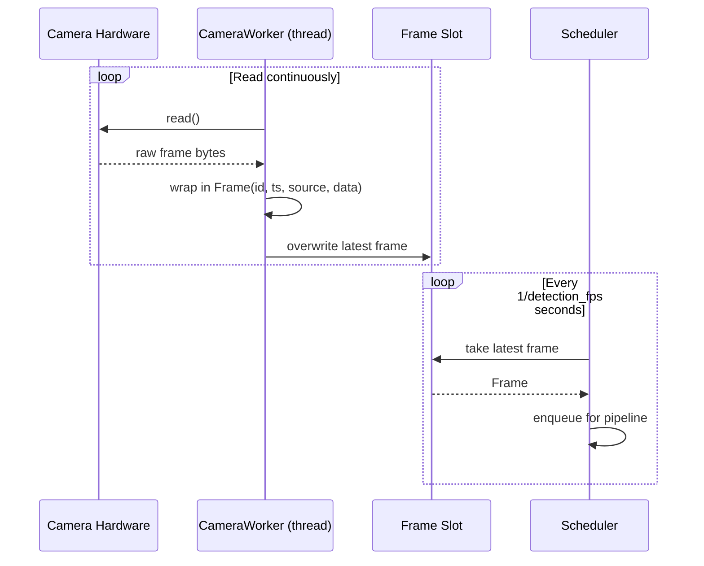
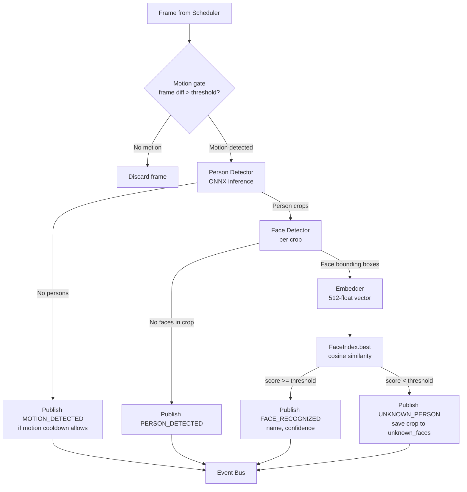
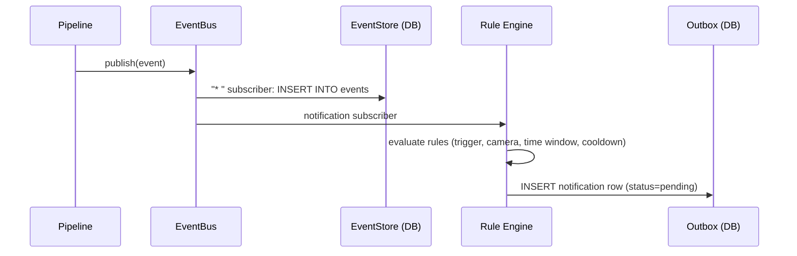
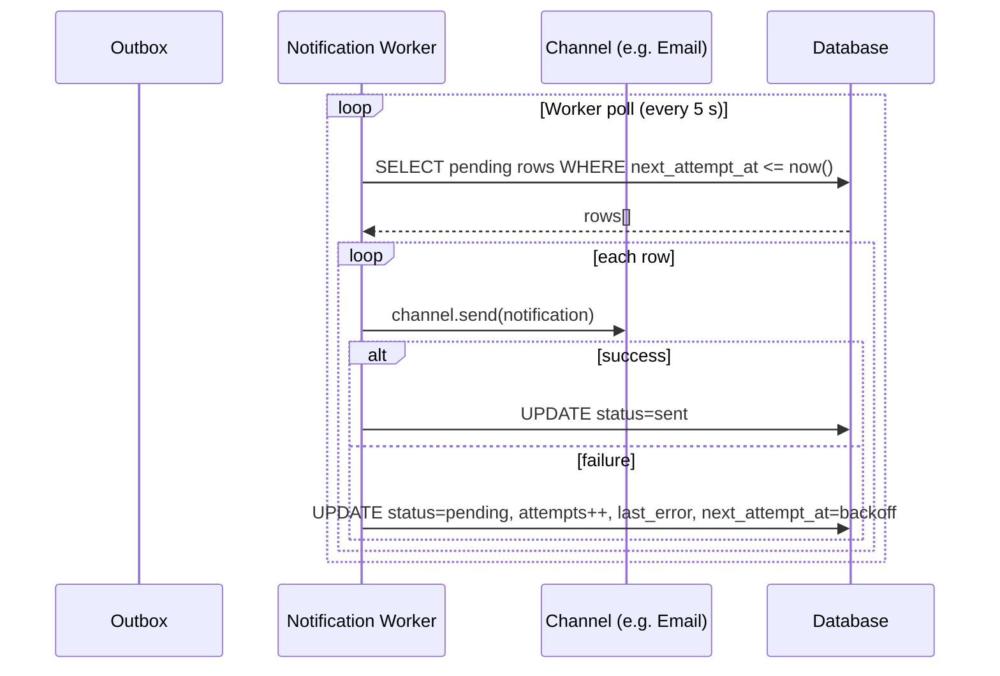
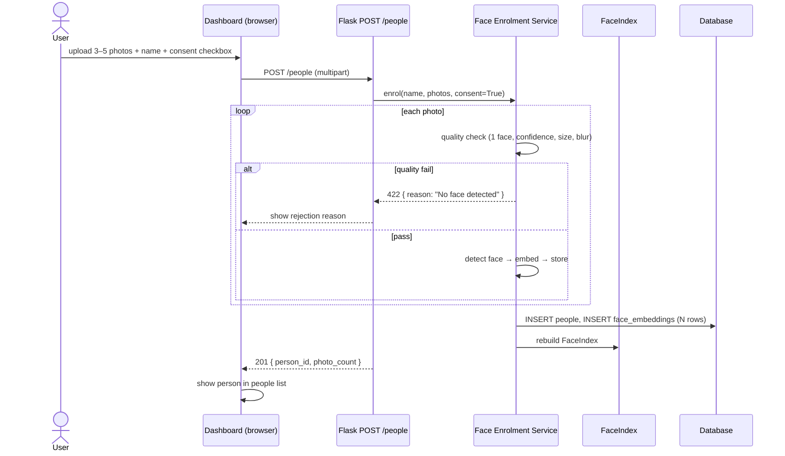
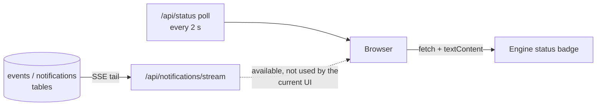

# Data Flow: Project Sentinel

> This document traces data from camera capture through detection, persistence, and notification delivery, and from user interaction back through the system. Use it alongside [ARCHITECTURE.md](ARCHITECTURE.md).

---

## 1. Camera Input and Frame Lifecycle



**Key properties:**
- The CameraWorker thread reads at the camera's native FPS (e.g. 25 fps).
- The scheduler samples at `detection_fps` (default 3 fps) to keep CPU usage bounded.
- If the pipeline queue is full, the frame is dropped — no memory growth.
- Each `Frame` carries a UUID, UTC timestamp, camera source identifier, and the raw NumPy array.

---

## 2. Detection Pipeline



**Notes:**
- The motion gate maintains its own previous-frame state per camera instance.
- Face detection and embedding run once across all person crops in a frame, not once per crop.
- Per-camera, per-identity cooldown suppresses repeated `FACE_RECOGNIZED` events for the same person within the cooldown window.
- Snapshots are saved to disk for `MOTION_DETECTED` with a person present and for `UNKNOWN_PERSON`.

---

## 3. Event Processing and Persistence



- `EventBus.publish` calls each subscriber in `try/except`; a failure in one subscriber does not affect others.
- The `"*"` subscriber persists every event regardless of type.
- The rule engine evaluates synchronously but only inserts a DB row; actual delivery is asynchronous.
- The event bus does not push to browsers. The notification inbox has an SSE endpoint
  (`/api/notifications/stream`) that tails the inbox table; the current UI does not open it
  and instead polls `/api/status` every 2 s for the engine badge.

---

## 4. Notification Delivery



**Retry schedule:** 1 m → 5 m → 30 m → 2 h → permanent failure. Permanent failures are visible in the notification settings UI with the last error message.

**Channels run independently.** A failing email channel does not delay or block Telegram delivery.

---

## 5. User Interaction: Enrolment



---

## 6. User Interaction: Unknown Face Promotion

```mermaid
sequenceDiagram
    actor User
    participant UI as Dashboard
    participant API as Flask POST /unknown/<id>/name
    participant FE as Face Enrolment Service
    participant FI as FaceIndex
    participant DB as Database

    User->>UI: open Unknown Faces inbox
    UI->>API: GET /api/unknown-faces
    API-->>UI: list of crops with thumbnails

    User->>UI: "Name this person" → type name → submit
    UI->>API: POST /api/unknown-faces/{id}/promote { name, consent }
    API->>FE: promote(unknown_face_id, name, consent)
    FE->>DB: INSERT people, INSERT face_embeddings (from unknown_faces.vector)
    FE->>DB: UPDATE unknown_faces SET status=promoted
    FE->>FI: rebuild FaceIndex
    API-->>UI: 200
    UI->>UI: move face to People list; remove from inbox
```

---

## 7. Database Persistence Summary

| Data type | Table | Retained | Deleted by |
|-----------|-------|----------|-----------|
| Domain events | `events` | Retention period (default 30 d) | Nightly sweeper |
| Snapshots (file + DB row) | `events.snapshot_path` + file | Retention period | Nightly sweeper |
| Person records | `people` | Until explicit delete | User action |
| Face embeddings | `face_embeddings` | Until person deleted | User action / "Delete person" |
| Unknown face crops | `unknown_faces` | Shorter retention (default 7 d) or until promoted/dismissed | Nightly sweeper + user action |
| Notification outbox | `notification_outbox` | Until delivered or max retries | Worker on delivery / failure |
| Audit log | `audit_log` | Longer retention (default 90 d) | Nightly sweeper |

---

## 8. Live Dashboard Data Flow



The shipped JavaScript (`static/js/app.js`) polls `/api/status` every two seconds and updates
the engine badge with `textContent` (never `innerHTML`). Event lists are rendered
server-side on page load and after a form post. `/api/notifications/stream` streams inbox
rows as Server-Sent Events for a client that chooses to use it; nothing in the current
templates opens an `EventSource`.

## 9. Data Leaving the Machine

By default, **no data leaves the customer's machine**. The only outbound traffic is:

| Destination | When | What |
|-------------|------|------|
| Customer's SMTP server | Notification delivery | Alert text + optional snapshot |
| Push notification relay (browser vendors) | Web Push delivery | End-to-end encrypted payload (event type + text; no snapshot) |
| Customer's webhook URL | Notification delivery | Configured JSON payload |
| Customer's Telegram bot API | Notification delivery | Alert text + optional photo |
| Licence verification endpoint (future) | On licence check | Licence key signature; no biometric data |

Telemetry: **none** by default. Any future opt-in analytics will document every field sent.
