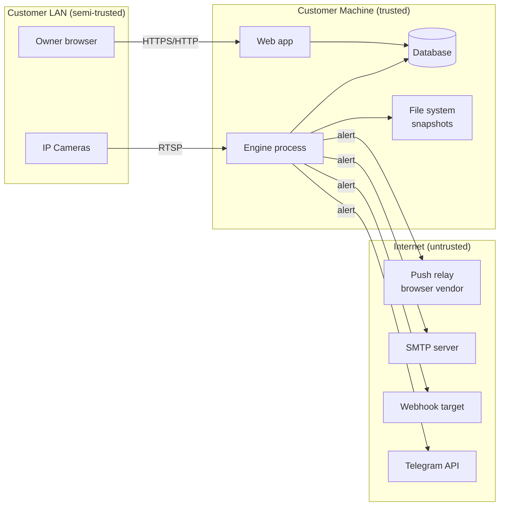

# Threat Model: Project Sentinel

> Not a security audit. Covers the target MVP architecture. Verify controls against the actual codebase; several are proposed, not yet implemented.

---

## 1. Assets

| Asset | Why it matters | Classification |
|-------|---------------|----------------|
| Camera streams and RTSP credentials | Access to the inside of people's homes or workplaces | Highly sensitive |
| Face embeddings and enrolment photos | Biometric data; cannot be "reset" unlike a password | Special category |
| Snapshots and event history | Reveals presence, absence, and visitor patterns | Sensitive |
| Admin account and session | Controls everything above | Highly sensitive |
| Notification channel credentials (SMTP password, webhook URL, bot token, VAPID private key) | Impersonation, spam, data exfiltration | Sensitive |
| Licence signing private key (Sentinel's) | Allows anyone to mint valid licence keys | Business-critical |
| Sentinel source code / model weights | Intellectual property | Business-sensitive |

---

## 2. Trust Boundaries

**Key trust boundaries:**
- **Camera → Engine:** camera firmware could be compromised; a malicious RTSP stream could try to exploit OpenCV parsing.
- **Browser → Web app:** any device on the LAN can reach the app when LAN access is enabled.
- **Engine → Internet:** outbound only by design (no inbound connections from the internet in MVP).
- **User input → Database:** web forms and API inputs are untrusted.

---

## 3. Threat Actors

| Actor | Access level | Motivation |
|-------|-------------|-----------|
| Attacker on the same Wi-Fi | LAN | Access camera feeds, control the engine, spy on movements |
| Remote attacker | Internet (if port-forwarded) | Same as LAN attacker; also data theft, ransomware |
| Physical attacker (stolen machine) | Physical access | Extract face data, credentials, camera feeds |
| Malicious camera firmware | LAN / RTSP | RTSP exploit, DNS rebinding, SSRF |
| Malicious enrolment user | Authenticated | Poison the face database; enrol their own face; delete others |
| Curious household member | Unauthenticated or authenticated viewer | View event history; face data |
| Sentinel itself (accidental) | — | Leaking secrets in logs, transmitting data unintentionally |

---

## 4. STRIDE Analysis

### S — Spoofing

| Threat | Vector | Mitigation | Status |
|--------|--------|-----------|--------|
| S-1 | An attacker forges another user's session cookie | Weak or missing `SECRET_KEY` | Signed session cookie; `SECRET_KEY` required; `HttpOnly` | Proposed |
| S-2 | A printed photo fools the face matcher | No liveness detection | Disclosed; not marketed as access control | Accepted risk |
| S-3 | Attacker replays a valid request to `/api/engine/start` | No CSRF protection | CSRF token on all state-changing requests | Proposed |

### T — Tampering

| Threat | Vector | Mitigation | Status |
|--------|--------|-----------|--------|
| T-1 | Attacker replaces `sentinel.db` with a crafted file; `pickle.loads()` executes arbitrary code | Access to file system | **Replace `pickle` with raw `float32` bytes** | Prototype: **not fixed** |
| T-2 | SQL injection via unsanitised input | String-assembled queries | Parameterised queries / ORM only (non-negotiable) | Proposed |
| T-3 | Attacker modifies snapshots or event records | File system access | File permissions; authenticated snapshot serving | Proposed |
| T-4 | Malicious licence key tampers with tier limits | Invalid key accepted | Ed25519 offline verification; embedded public key | Proposed |

### R — Repudiation

| Threat | Vector | Mitigation | Status |
|--------|--------|-----------|--------|
| R-1 | No record of who enrolled or deleted a face | Missing audit trail | Audit log: all enrol/delete/settings/login events | Proposed |
| R-2 | No record of failed login attempts | Missing audit trail | Same audit log | Proposed |

### I — Information Disclosure

| Threat | Vector | Mitigation | Status |
|--------|--------|-----------|--------|
| I-1 | Telegram bot token and chat ID hardcoded in source | Anyone with repo access | **Move to `.env`; revoke old token** | Prototype: **critical, unmitigated** |
| I-2 | Credentials appear in logs | Logging camera URLs with passwords | Mask credentials in all log output | Proposed |
| I-3 | Snapshot files served without authentication | Static file route | Serve through authenticated route only; never expose as static | Proposed |
| I-4 | Face embeddings leaked via API | Embedding returned in API response | Never return raw embeddings via the API | Proposed |
| I-5 | Detailed error messages expose internal paths | 500 responses with stack traces | Generic errors to clients; full detail in logs only | Proposed |
| I-6 | Camera RTSP URL with password visible in DB backup | Plaintext storage | Fernet encryption; key from `SECRET_KEY` in `.env` | Proposed |
| I-7 | Diagnostics bundle contains secrets | Log files, DB path, env dump | Strip all secrets before bundling | Proposed |

### D — Denial of Service

| Threat | Vector | Mitigation | Status |
|--------|--------|-----------|--------|
| D-1 | Attacker submits large file uploads to exhaust disk | Unauthenticated upload route | Auth on all routes; upload size limits; type validation | Proposed |
| D-2 | High-resolution camera stream exhausts CPU | No frame rate cap | Detection FPS cap per camera; frame dropping | Proposed |
| D-3 | Login brute force | Repeated POST /login | 5 failures per (IP, username) or 20 per IP / 15 min, then 429 + `Retry-After` (`src/security/ratelimit.py`) | **Implemented** (in-process only) |
| D-4 | Disk fills from unlimited snapshot accumulation | No retention | Retention sweeper; disk-free floor guard | Proposed |
| D-5 | Notification outbox grows unbounded on network loss | No backoff cap | Max retry count; permanent failure state | Proposed |

### E — Elevation of Privilege

| Threat | Vector | Mitigation | Status |
|--------|--------|-----------|--------|
| E-1 | Viewer role accesses admin routes | Missing authorisation check | Role check middleware on every admin route | Proposed |
| E-2 | Unauthenticated access to dashboard | No login (prototype) | **Auth on every route** | Prototype: **unmitigated** |
| E-3 | CSRF attack triggers engine stop/start | No CSRF (prototype) | CSRF token enforcement | Prototype: **unmitigated** |
| E-4 | RTSP URL contains a local `file://` or `http://localhost` path (SSRF) | Attacker controls camera config | Allow-list schemes: `rtsp`, `rtsps`, `http`, `https`, integer device index only | Proposed |

---

## 5. Risk Priority Matrix

| ID | Severity | Likelihood | Priority | Current state |
|----|----------|-----------|----------|--------------|
| I-1 Hardcoded token | Critical | Certain | **P0 — fix today** | Unmitigated |
| E-2 No auth | Critical | High | **P0** | Unmitigated |
| T-1 pickle RCE | Critical | Medium | **P0** | Unmitigated |
| E-3 No CSRF | High | Medium | P1 | Unmitigated |
| I-3 Unauthenticated snapshots | High | High | P1 | Unmitigated |
| I-6 Plaintext camera credentials | High | Medium | P1 | Unmitigated |
| E-1 Role bypass | High | Medium | P1 | Unmitigated |
| I-2 Credentials in logs | Medium | Medium | P2 | Unmitigated |
| D-3 Login brute force | Medium | Medium | P2 | Proposed |
| E-4 SSRF via camera URL | Medium | Low | P2 | Proposed |
| S-2 Photo spoofing | Medium | High | Accepted risk | Disclosed |
| D-4 Disk exhaustion | Medium | High | P2 | Proposed |

---

## 6. Out-of-Scope Threats (MVP)

- Physical device theft (outside software scope; document disk encryption guidance)
- Compromise of the customer's router or ISP
- Supply-chain attack on `pip` packages (mitigated by `pip-audit` + pinned versions in CI; not fully preventable)
- Zero-day in OpenCV RTSP parsing (mitigate by not running as root; no inbound internet connections)
- Multi-tenancy isolation (Sentinel is single-tenant per machine)

---

## 7. Mitigations Roadmap

| Phase | Mitigations |
|-------|------------|
| **Phase 0 (now)** | Revoke hardcoded token; remove from source; `pickle` → float32 bytes |
| **Phase 1** | Auth + CSRF + localhost bind + role checks + no-credential logs |
| **Phase 2** | Fernet-encrypted camera credentials; authenticated snapshot serving; upload validation |
| **Phase 3** | Audit log; SSRF allow-list; login rate-limit |
| **Phase 4** | Diagnostics secrets scrubber; disk-free guard; retention sweeper |
| **Phase 5** | `pip-audit` + `bandit` in CI; `gitleaks` push protection; `SECURITY.md`; penetration test recommendation |
| **Post-MVP** | Liveness detection (disclose until then); E2E-encrypted cloud relay |
